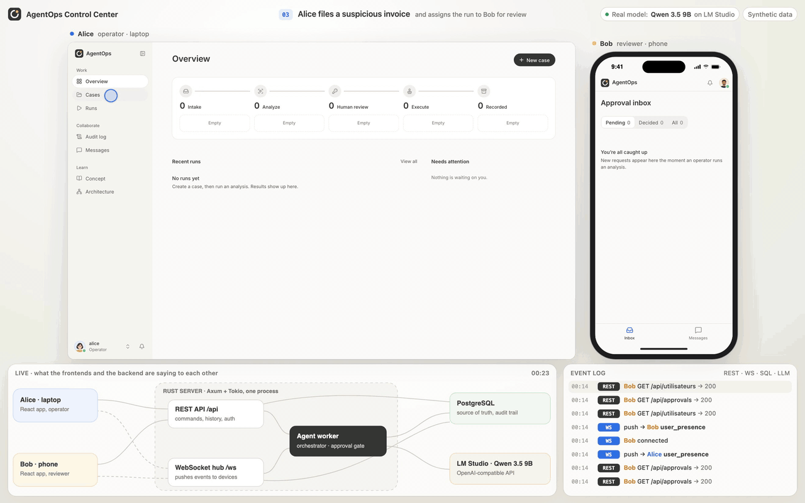
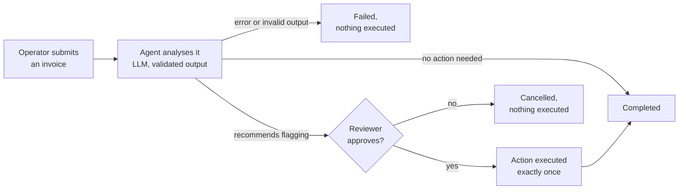
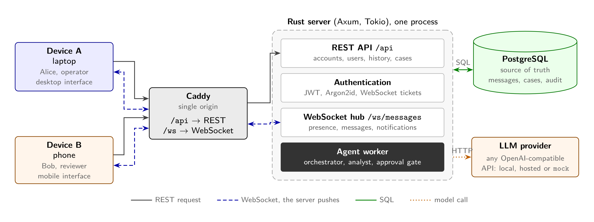

<div align="center">


# AgentOps Control Center

A human-in-the-loop control plane for agentic AI: the LLM agent recommends, a person approves from any device,
and approved invoice updates are committed with an audit record.

[Demo video](docs/demo/agentops-demo.mp4) · [What it shows](#what-this-project-shows) · [Workflow](#the-workflow) · [Engineering decisions](#engineering-decisions) · [Architecture](#architecture) · [Run it](#run-it)

<a href="docs/demo/agentops-demo.mp4"></a>

<sub>28 seconds of the demo at 4× speed: a real model (Qwen 3.5 9B on LM Studio), two devices and the live
backend traffic underneath. <a href="docs/demo/agentops-demo.mp4"><b>Watch the full 4-minute demo</b></a>.</sub>

</div>

## Overview

AgentOps is an invoice-review application with an LLM recommendation step and a human approval gate.
An operator submits an invoice; the model compares its amount with the vendor's recorded average and
recommends either flagging it or taking no action. An assigned reviewer approves or rejects a proposed flag,
with messaging available between the operator and reviewer.

The invoice data and accounts are synthetic. The application runs as a single server instance and supports
both a deterministic mock model and an OpenAI-compatible model endpoint.

## What this project shows

- **Model integration.** Structured JSON output, typed validation, bounded retries and timeouts, plus a
  fallback for model servers that reject the JSON-schema response format.
- **Backend approval policy.** The model selects from a fixed action allowlist; the backend decides whether
  approval is required. Model timeouts and invalid output stop the run before an invoice update.
- **Approval workflow.** Eight run states, conditional database transitions and live reviewer notifications.
- **Transactional invoice updates.** The case update and execution record share one PostgreSQL transaction.
  A unique approval ID prevents duplicate updates when an execution is retried. Startup recovery resumes
  approved runs and marks interrupted analysis runs as failed.
- **Audit timeline.** Run transitions, model attempts, reviewer decisions and action results are recorded
  in PostgreSQL and displayed in the interface.
- **Messaging.** WebSocket presence, persisted messages, offline delivery and live status updates.
- **Authentication and tooling.** Argon2id password hashes, JWT access tokens, rotating refresh cookies,
  single-use WebSocket tickets, Origin checks, WebSocket message rate limits, OpenAPI, Docker Compose and CI.

## The workflow


<sub>An agent run stopped at the approval gate: the analysis, the proposed action, the agent calls and the live audit
trail.</sub>

<table>
<tr>
<td width="34%"></td>
<td></td>
</tr>
<tr>
<td><sub>The reviewer sees what the agent proposes and why, then decides.</sub></td>
<td><sub>Operator and reviewer talk the decision over in real time, on any device.</sub></td>
</tr>
</table>



## Engineering decisions

| Decision | Why |
| --- | --- |
| The model returns a typed recommendation; Rust executes the action | The model can be wrong or manipulated by the invoice text; it can change a recommendation, never add an action |
| Approval policy lives in the backend | The model's own `requiresApproval` field is ignored; sensitive actions always need a human |
| `UNIQUE(approval_id)` on executions, inside the business transaction | The invoice update and its execution record commit together; the unique approval ID prevents duplicates |
| Transitions as `UPDATE … WHERE status = expected` | Two concurrent actors cannot both move a run; the loser gets a clean `409` |
| REST for commands and history, WebSocket for push | PostgreSQL stays the source of truth; a client that missed events just refetches |
| OpenAI-compatible HTTP client instead of an SDK | One client for local servers (LM Studio) and hosted APIs; full control over retries and error classification |
| Single Rust process (Axum, Tokio, SQLx) | One deployable unit with typed domain enums, embedded migrations and a low-latency WebSocket hub |
| OpenAPI generated from the Rust code, checked in CI | The published API description cannot drift from the implementation |

## Architecture



Clients only talk to the server, through a single origin. The agent worker runs inside the server process, calls the
LLM, writes every step to PostgreSQL and pushes status changes over the WebSocket hub. Data model, state machine,
sequence diagrams and security model: [`docs/architecture.md`](docs/architecture.md).

**Stack:** Rust (Axum, Tokio, SQLx, Utoipa) · PostgreSQL 17 · React 19, TypeScript, TanStack Router and Query,
Zustand, Tailwind · Docker Compose, Caddy · GitHub Actions · Playwright, Vitest.

**Tests:** 29 backend tests (22 integration tests against a real PostgreSQL, plus an opt-in one against a real model), 55
frontend tests, and 3 end-to-end scenarios driving two browsers at once: messaging, approval and rejection.

**Scope:** this is an MVP. The invoice workflow is the demonstration case, the model defaults to the mock, there are
two roles (operator and reviewer) and the server runs as a single instance.

## Run it

Docker Desktop is enough for the full stack:

```bash
cp .env.example .env               # then set JWT_SECRET (openssl rand -base64 48)
docker compose up --build          # postgres + backend + demo seed + web
```

Open <http://localhost:8080> (Swagger UI at `/api/docs`). From a phone on the same Wi-Fi, open
`http://<laptop-LAN-IP>:8080`. To use a real model, set `LLM_MODE=real` and point `LLM_BASE_URL` at any
OpenAI-compatible endpoint ([details](docs/development.md#4-real-llm-mode)).

Demo accounts (synthetic), password `demo-password-123` for all:

| Username | Role |
| --- | --- |
| alice, carol | Operator |
| bob, dave | Reviewer |

### Host development, hot reload

Needs Rust 1.92+, Node.js 24+ and pnpm 9.

```bash
docker compose up -d postgres
cp .env.example .env               # set JWT_SECRET
cd backend && cargo run            # terminal 1: API on :8080, runs migrations
cd backend && cargo run --bin seed # terminal 2: demo users
cd apps/web && pnpm install && pnpm dev   # terminal 3: http://localhost:5173
```

### Tests

```bash
cd backend && cargo test
cd apps/web && pnpm typecheck && pnpm lint && pnpm test
cd tests/e2e && pnpm install && pnpm exec playwright test   # backend (LLM_MODE=mock) and frontend running
```

Or in containers: `docker compose --profile test run --rm backend-test` and `... run --rm e2e`.

The [development guide](docs/development.md) covers the
[environment variables](docs/development.md#3-environment-variables), the
[Docker services](docs/development.md#7-docker-full-stack) and [troubleshooting](docs/development.md#8-troubleshooting).

## Repository layout

| Path | Contents |
| --- | --- |
| [`backend/`](backend) | Rust API, WebSocket hub, agent worker, LLM layer, SQL migrations; [module map](backend/README.md) |
| [`apps/web/`](apps/web) | React single-page app for desktop and mobile; [design rules](apps/web/DESIGN.md) |
| [`contracts/`](contracts) | [`CONTRACT.md`](contracts/CONTRACT.md): REST, WebSocket and state machine contract, plus the OpenAPI file |
| [`tests/e2e/`](tests/e2e) | Playwright scenarios with two browser contexts |
| [`infra/`](infra) | Dockerfiles and the Caddy configuration |
| [`docs/`](docs) | [Architecture](docs/architecture.md), [API reference](docs/api.md), [development guide](docs/development.md) |

## Authors

Daniil Hirchyts and Mattéo Louet, EFREI Paris.

## License

[MIT](LICENSE). All demo accounts and data are synthetic.
