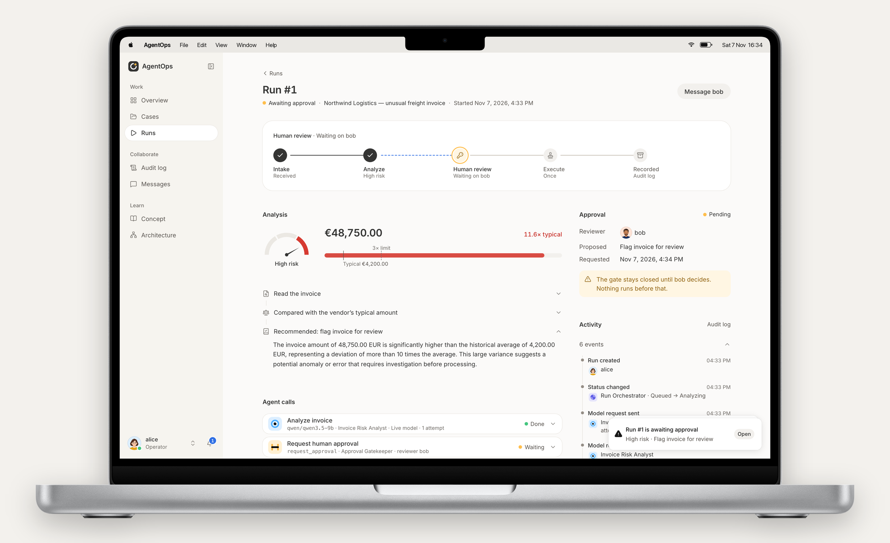
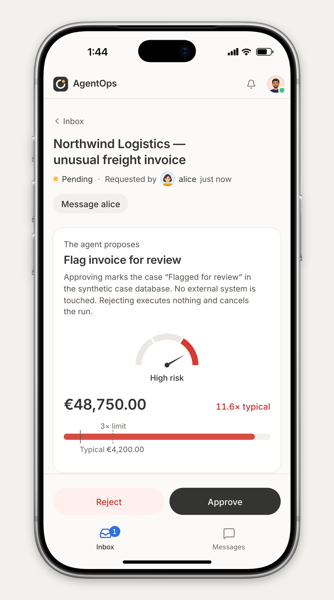
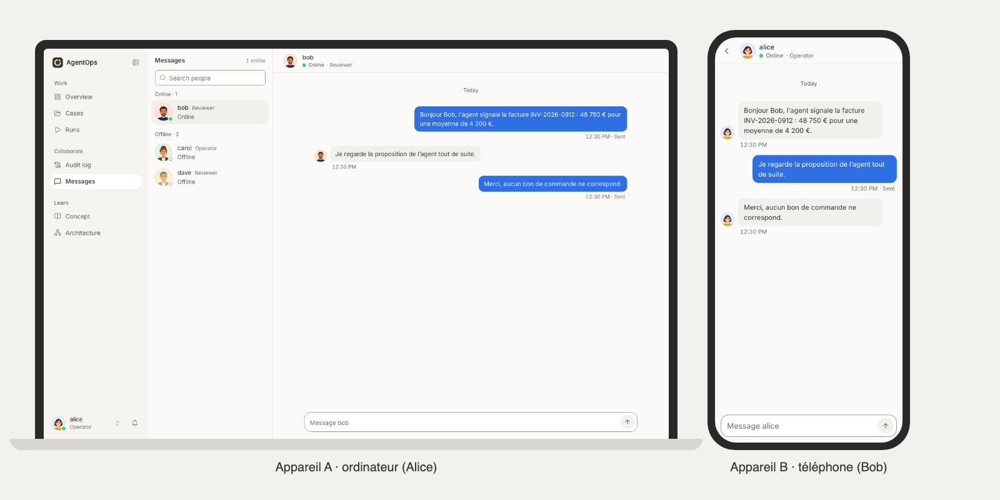
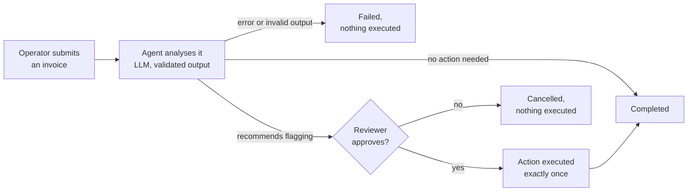
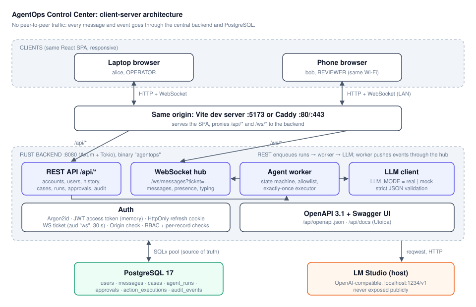

<div align="center">


# AgentOps Control Center

A human-in-the-loop control plane for agentic AI: the LLM agent recommends, a person approves from any device,
and the action runs exactly once, with every step audited.

[What it shows](#what-this-project-shows) · [Workflow](#the-workflow) · [Engineering decisions](#engineering-decisions) · [Architecture](#architecture) · [Run it](#run-it)



<sub>An agent run stopped at the approval gate: the analysis, the proposed action, the agent calls and the live audit
trail.</sub>

</div>

## Overview

Companies want agentic AI that acts, not just answers, but an action with consequences (blocking a payment, changing
a record) cannot be left to a model on its own. AgentOps is an end-to-end, full-stack system built around that problem:
an LLM agent analyses a business case and proposes a tool call, guardrails and policy run in the backend, a human
reviewer decides in real time, and only then does the action run. It is the kind of agentic workflow automation that
gets deployed inside a customer's existing process, with governance and observability built in.

The use case is accounts-payable fraud review. An operator submits an invoice; the agent compares it with the vendor's
history, assesses the risk and recommends flagging it; a reviewer gets the request on their phone, discusses it with
the operator in the built-in chat, and approves or rejects. The data is synthetic; the patterns (approval gates,
idempotent actions, audit trail, model-agnostic integration) are the ones an enterprise deployment needs.

**Keywords:** agentic AI · AI agents · LLM orchestration · tool calling · structured outputs · guardrails ·
human-in-the-loop (HITL) · AI governance · observability · audit trail · enterprise workflow automation ·
OpenAI-compatible APIs · real-time systems · full-stack · Rust · TypeScript · React · PostgreSQL · Docker

## What this project shows

- **Production LLM integration.** A model-agnostic, provider-agnostic layer over any OpenAI-compatible API (local or
  hosted), strict JSON-schema output with a fallback for servers that reject it, typed validation, bounded retries and
  timeouts. A deterministic mock makes the whole system testable without a GPU or an API key.
- **Guardrails outside the model.** The model only recommends, through a tool-calling pattern with structured outputs. Actions come from a fixed allowlist implemented in
  Rust, the backend (not the model) decides what needs approval, and every failure path ends in `FAILED`, never in an
  executed action.
- **Human in the loop as a first-class state.** An eight-state run lifecycle with an explicit approval gate,
  race-safe transitions, and live notifications to the assigned reviewer on any device.
- **Safe side effects.** An approved action runs exactly once, even after a double click, a retry or a server
  restart, enforced by the database. Interrupted runs are recovered at startup.
- **Observability and AI governance.** Every run, model request and response, decision and action is recorded with
  its actor and shown as an audit timeline; logs never contain secrets or tickets.
- **Real-time product, not a demo script.** WebSocket presence, messaging with offline delivery, live status on
  desktop and mobile, and a responsive React interface designed for daily use.
- **Production hygiene.** Argon2id, short-lived JWTs, HttpOnly refresh cookie with rotation, single-use WebSocket
  tickets, Origin checks, rate limits, OpenAPI 3.1, Docker Compose, CI, and tests at every level.

## The workflow

<table>
<tr>
<td width="34%"></td>
<td></td>
</tr>
<tr>
<td><sub>The reviewer sees what the agent proposes and why, then decides.</sub></td>
<td><sub>Operator and reviewer talk the decision over in real time, on any device.</sub></td>
</tr>
</table>



## Engineering decisions

| Decision | Why |
| --- | --- |
| The model returns a typed recommendation; Rust executes the action | The model can be wrong or manipulated by the invoice text; it can change a recommendation, never add an action |
| Approval policy lives in the backend | The model's own `requiresApproval` field is ignored; sensitive actions always need a human |
| `UNIQUE(approval_id)` on executions, inside the business transaction | Exactly-once execution without distributed locks; retries and restarts are safe |
| Transitions as `UPDATE … WHERE status = expected` | Two concurrent actors cannot both move a run; the loser gets a clean `409` |
| REST for commands and history, WebSocket for push | PostgreSQL stays the source of truth; a client that missed events just refetches |
| OpenAI-compatible HTTP client instead of an SDK | One client for local servers (LM Studio) and hosted APIs; full control over retries and error classification |
| Single Rust process (Axum, Tokio, SQLx) | One deployable unit with typed domain enums, embedded migrations and a low-latency WebSocket hub |
| OpenAPI generated from the Rust code, checked in CI | The published API description cannot drift from the implementation |

## Architecture



Clients only talk to the server, through a single origin. The agent worker runs inside the server process, calls the
LLM, writes every step to PostgreSQL and pushes status changes over the WebSocket hub. Data model, state machine,
sequence diagrams and security model: [`docs/architecture.md`](docs/architecture.md).

**Stack:** Rust (Axum, Tokio, SQLx, Utoipa) · PostgreSQL 17 · React 19, TypeScript, TanStack Router and Query,
Zustand, Tailwind · Docker Compose, Caddy · GitHub Actions · Playwright, Vitest.

**Tests:** 28 backend integration tests against a real PostgreSQL (plus an opt-in test against a real model), 55
frontend tests, and 3 end-to-end scenarios driving two browsers at once: messaging, approval and rejection.

**Scope:** this is an MVP. The invoice workflow is the demonstration case, the model defaults to the mock, there are
two roles (operator and reviewer) and the server runs as a single instance.

## Run it

Docker Desktop is enough for the full stack:

```bash
cp .env.example .env               # then set JWT_SECRET (openssl rand -base64 48)
docker compose up --build          # postgres + backend + demo seed + web
```

Open <http://localhost:8080> (Swagger UI at `/api/docs`). From a phone on the same Wi-Fi, open
`http://<laptop-LAN-IP>:8080`. To use a real model, set `LLM_MODE=real` and point `LLM_BASE_URL` at any
OpenAI-compatible endpoint ([details](docs/development.md#4-real-llm-mode)).

Demo accounts (synthetic), password `demo-password-123` for all:

| Username | Role |
| --- | --- |
| alice, carol | Operator |
| bob, dave | Reviewer |

### Host development, hot reload

Needs Rust 1.92+, Node.js 24+ and pnpm 9.

```bash
docker compose up -d postgres
cp .env.example .env               # set JWT_SECRET
cd backend && cargo run            # terminal 1: API on :8080, runs migrations
cd backend && cargo run --bin seed # terminal 2: demo users
cd apps/web && pnpm install && pnpm dev   # terminal 3: http://localhost:5173
```

### Tests

```bash
cd backend && cargo test
cd apps/web && pnpm typecheck && pnpm lint && pnpm test
cd tests/e2e && pnpm install && pnpm exec playwright test   # backend (LLM_MODE=mock) and frontend running
```

Or in containers: `docker compose --profile test run --rm backend-test` and `... run --rm e2e`.

The [development guide](docs/development.md) covers the
[environment variables](docs/development.md#3-environment-variables), the
[Docker services](docs/development.md#7-docker-full-stack) and [troubleshooting](docs/development.md#8-troubleshooting).

## Repository layout

| Path | Contents |
| --- | --- |
| [`backend/`](backend) | Rust API, WebSocket hub, agent worker, LLM layer, SQL migrations; [module map](backend/README.md) |
| [`apps/web/`](apps/web) | React single-page app for desktop and mobile; [design rules](apps/web/DESIGN.md) |
| [`contracts/`](contracts) | [`CONTRACT.md`](contracts/CONTRACT.md): REST, WebSocket and state machine contract, plus the OpenAPI file |
| [`tests/e2e/`](tests/e2e) | Playwright scenarios with two browser contexts |
| [`infra/`](infra) | Dockerfiles and the Caddy configuration |
| [`docs/`](docs) | [Architecture](docs/architecture.md), [API reference](docs/api.md), [development guide](docs/development.md) |

## Authors

Daniil Hirchyts and Mattéo Louet, EFREI Paris.

## License

[MIT](LICENSE). All demo accounts and data are synthetic.
