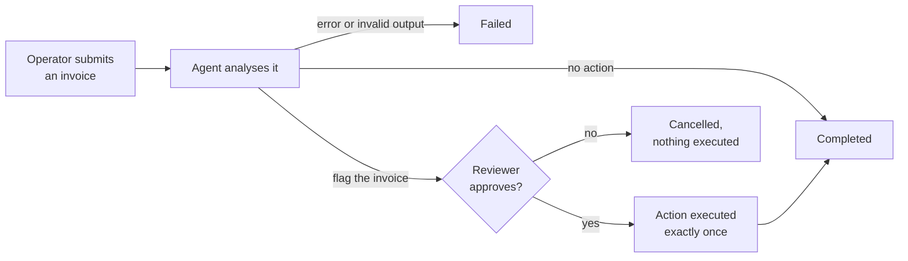

<div align="center">


# AgentOps Control Center

Instant messaging between two devices, extended into a console where people approve what an AI agent wants to do.

[Report (FR)](docs/report/rapport.pdf) · [Architecture](docs/architecture.md) · [API](docs/api.md) · [Assignment coverage](#assignment-coverage) · [Run it](#run-it)


<sub>Alice on a laptop and Bob on a phone: two independent sessions exchanging messages through the server, on synthetic data.</sub>

</div>

## About

The assignment asks for an instant-messaging API between two devices: accounts, JWT login, a user list, messages over
WebSocket and history over REST. AgentOps builds that, then uses it for a concrete job: supervising an AI agent.

- **Agents and approvals:** an operator submits an invoice; an agent (any OpenAI-compatible model, or a deterministic
  mock) assesses the risk and proposes an action through a tool call; a reviewer approves or rejects it in real time
  from another device; the approved action is executed exactly once and every step is audited.
- **Real-time collaboration:** live presence, messages with offline delivery and a typing indicator, so the operator
  and the reviewer can talk the decision over.
- **Learn pages in the app:** `/learn/concept` explains what is simulated and what each demo case is for;
  `/learn/architecture` walks through the servers, REST vs WebSocket and the approval loop with live diagrams.

This is an MVP. The invoice case is simulated, the model is a mock by default, there are two fixed roles and a single
server instance; these simplifications are deliberate and listed in the report.

Stack: Rust (Axum, Tokio, SQLx) · PostgreSQL 17 · React + Vite + TypeScript · Docker Compose · Caddy.

## Assignment coverage

| Requirement | Implementation |
| --- | --- |
| Account creation | `POST /api/comptes`, Argon2id hashing, database constraints |
| JWT authentication | `POST /api/auth/login`, Bearer access token, HttpOnly refresh cookie |
| User list | `GET /api/utilisateurs`, with a live `online` flag |
| Real-time messages over WebSocket | `/ws/messages`, delivered to the recipient and echoed to the sender |
| History over REST | `GET /api/messages/{utilisateurId}` |
| Offline recipient | messages stored before delivery, refetched over REST on reconnect |
| WebSocket security | short-lived ticket, Origin check, frame size and rate limits |
| Persistence | PostgreSQL, migrations embedded in the binary |
| Two-device demo | laptop and phone on the same Wi-Fi, [script](docs/development.md#6-two-device-demo) |
| Bonus | OpenAPI / Swagger UI, typing indicator, WebSocket rate limiting |
| Extension | AI agent with human approval, state machine, exactly-once execution, audit trail |
| Tests | backend integration tests, frontend tests, two-browser Playwright E2E |

## How it works


Both devices talk only to the server, never to each other. REST carries reads and commands (login, history, cases,
decisions); the WebSocket pushes what just happened (messages, presence, run status). PostgreSQL is the single source of
truth. An agent run follows this loop:



Every transition is written to the audit log and pushed to both people over the WebSocket. Details, data model and
security model: [`docs/architecture.md`](docs/architecture.md).

## Run it

Docker Desktop is enough for the full stack:

```bash
cp .env.example .env               # then set JWT_SECRET (openssl rand -base64 48)
docker compose up --build          # postgres + backend + demo seed + web
```

Open <http://localhost:8080> (Swagger UI at `/api/docs`). From a phone on the same Wi-Fi, open
`http://<laptop-LAN-IP>:8080`.

Demo accounts (synthetic), password `demo-password-123` for all:

| Username | Role |
| --- | --- |
| alice, carol | OPERATOR |
| bob, dave | REVIEWER |

### Host development, hot reload

Needs Rust 1.92+, Node.js 24+ and pnpm 9.

```bash
docker compose up -d postgres
cp .env.example .env               # set JWT_SECRET
cd backend && cargo run            # terminal 1: API on :8080, runs migrations
cd backend && cargo run --bin seed # terminal 2: demo users
cd apps/web && pnpm install && pnpm dev   # terminal 3: http://localhost:5173
```

### Tests

```bash
cd backend && cargo test
cd apps/web && pnpm typecheck && pnpm lint && pnpm test
cd tests/e2e && pnpm install && pnpm exec playwright test   # backend (LLM_MODE=mock) and frontend running
```

Or in containers: `docker compose --profile test run --rm backend-test` and `... run --rm e2e`.

The [development guide](docs/development.md) covers the
[environment variables](docs/development.md#3-environment-variables), a
[real LLM](docs/development.md#4-real-llm-mode), the [Docker services](docs/development.md#7-docker-full-stack) and
[troubleshooting](docs/development.md#8-troubleshooting).

## Repository layout

| Path | Contents |
| --- | --- |
| [`backend/`](backend) | Rust API and WebSocket server, SQL migrations; [its README](backend/README.md) maps the modules |
| [`apps/web/`](apps/web) | React single-page app; [design rules](apps/web/DESIGN.md) |
| [`contracts/`](contracts) | [`CONTRACT.md`](contracts/CONTRACT.md), the API, WebSocket and state machine contract, and the OpenAPI file |
| [`tests/e2e/`](tests/e2e) | Playwright tests with two browser contexts |
| [`infra/`](infra) | Dockerfiles and the Caddy configuration |
| [`docs/`](docs) | [Architecture](docs/architecture.md), [API reference](docs/api.md), [development guide](docs/development.md) |
| [`docs/report/`](docs/report) | French report: [PDF](docs/report/rapport.pdf) and LaTeX source |

## Authors

Daniil Hirchyts and Mattéo Louet, for API et Web Services at EFREI Paris, ING2 APP BDML 2, 2026–2027.

## License

Academic project, written for coursework. Not licensed for production use. All demo accounts and data are synthetic.
