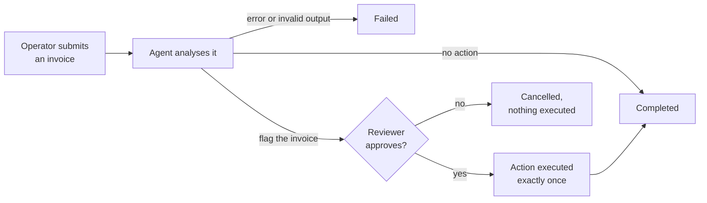

<div align="center">


# AgentOps Control Center

A console for supervising AI agents: the agent proposes, a person approves from any device, and the action runs
exactly once.

[Features](#features) · [How it works](#how-it-works) · [Run it](#run-it) · [Architecture](docs/architecture.md) · [API](docs/api.md)


<sub>Alice, the operator, and Bob, the reviewer, discuss a flagged invoice from a laptop and a phone (synthetic data).</sub>

</div>

## About

AI agents are useful until they want to do something that matters. AgentOps puts a person between the
recommendation and the action. An operator hands the agent a case, the agent analyses it and proposes an action
through a tool call, and a reviewer approves or rejects it in real time, from a laptop or a phone. The two can talk the
decision over in the built-in chat. Nothing runs without that approval, and every step is recorded.

The demo case is invoice fraud: an invoice far above the vendor's usual amount, with a change of bank details, gets
flagged for review.

## Features

- **Human approval for agent actions.** The model only recommends; actions come from a fixed allowlist, the backend
  decides what needs approval, and an approved action is executed exactly once, even after a retry or a restart.
- **Real-time messaging.** Accounts, live presence, typing indicator, and messages that reach offline users when they
  come back.
- **Any device.** The same app on desktop and mobile; status changes and approval requests appear live on both.
- **Bring your own model.** Any OpenAI-compatible API, local or hosted, or a deterministic mock that needs nothing.
- **Audit trail.** Every run, model response, decision and action is logged with its author.
- **Security by default.** Argon2id passwords, short-lived tokens kept in memory, an HttpOnly refresh cookie,
  single-use WebSocket tickets, Origin checks and rate limits.
- **Documented API.** OpenAPI 3.1 with Swagger UI, plus a reference with curl and WebSocket examples.
- **Explains itself.** In-app pages walk through the concept and the architecture with live diagrams.

AgentOps is an MVP: the invoice workflow is a demonstration case, the model is a mock by default, there are two fixed
roles (operator and reviewer) and the server runs as a single instance.

Stack: Rust (Axum, Tokio, SQLx) · PostgreSQL 17 · React + Vite + TypeScript · Docker Compose · Caddy.

## How it works


Both devices talk only to the server, never to each other. REST carries reads and commands (login, history, cases,
decisions); the WebSocket pushes what just happened (messages, presence, run status). PostgreSQL is the single source of
truth. An agent run follows this loop:



Every transition is written to the audit log and pushed to both people over the WebSocket. Details, data model and
security model: [`docs/architecture.md`](docs/architecture.md).

## Run it

Docker Desktop is enough for the full stack:

```bash
cp .env.example .env               # then set JWT_SECRET (openssl rand -base64 48)
docker compose up --build          # postgres + backend + demo seed + web
```

Open <http://localhost:8080> (Swagger UI at `/api/docs`). From a phone on the same Wi-Fi, open
`http://<laptop-LAN-IP>:8080`.

Demo accounts (synthetic), password `demo-password-123` for all:

| Username | Role |
| --- | --- |
| alice, carol | OPERATOR |
| bob, dave | REVIEWER |

### Host development, hot reload

Needs Rust 1.92+, Node.js 24+ and pnpm 9.

```bash
docker compose up -d postgres
cp .env.example .env               # set JWT_SECRET
cd backend && cargo run            # terminal 1: API on :8080, runs migrations
cd backend && cargo run --bin seed # terminal 2: demo users
cd apps/web && pnpm install && pnpm dev   # terminal 3: http://localhost:5173
```

### Tests

```bash
cd backend && cargo test
cd apps/web && pnpm typecheck && pnpm lint && pnpm test
cd tests/e2e && pnpm install && pnpm exec playwright test   # backend (LLM_MODE=mock) and frontend running
```

Or in containers: `docker compose --profile test run --rm backend-test` and `... run --rm e2e`.

The [development guide](docs/development.md) covers the
[environment variables](docs/development.md#3-environment-variables), a
[real LLM](docs/development.md#4-real-llm-mode), the [Docker services](docs/development.md#7-docker-full-stack) and
[troubleshooting](docs/development.md#8-troubleshooting).

## Repository layout

| Path | Contents |
| --- | --- |
| [`backend/`](backend) | Rust API and WebSocket server, SQL migrations; [its README](backend/README.md) maps the modules |
| [`apps/web/`](apps/web) | React single-page app; [design rules](apps/web/DESIGN.md) |
| [`contracts/`](contracts) | [`CONTRACT.md`](contracts/CONTRACT.md), the API, WebSocket and state machine contract, and the OpenAPI file |
| [`tests/e2e/`](tests/e2e) | Playwright tests with two browser contexts |
| [`infra/`](infra) | Dockerfiles and the Caddy configuration |
| [`docs/`](docs) | [Architecture](docs/architecture.md), [API reference](docs/api.md), [development guide](docs/development.md), screenshots |

## Authors

Daniil Hirchyts and Mattéo Louet, EFREI Paris.

## License

[MIT](LICENSE). All demo accounts and data are synthetic.
