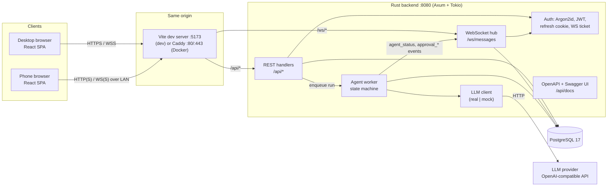
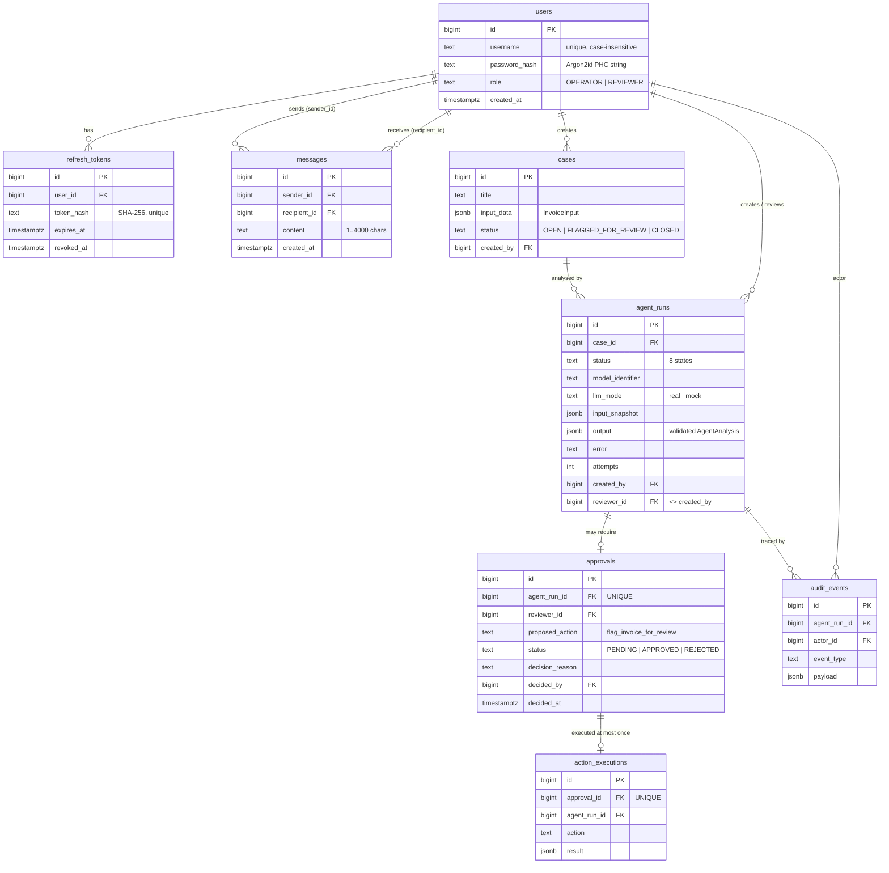
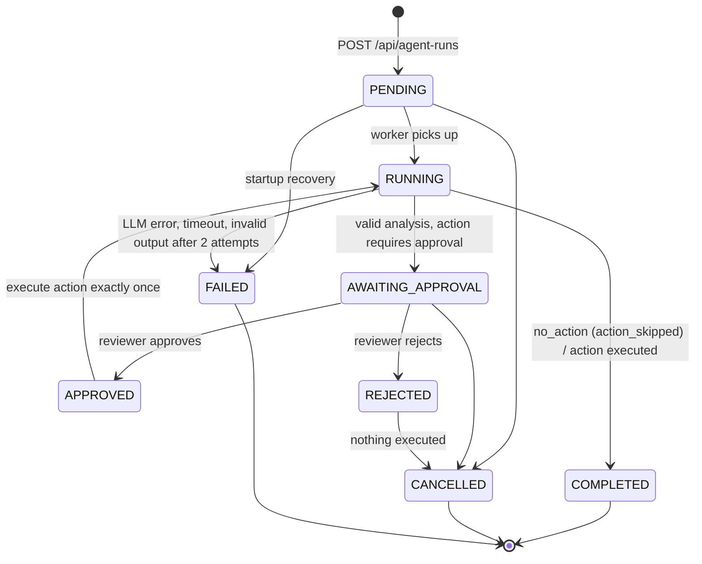

# Architecture

AgentOps Control Center is a client–server application. Every client (desktop browser, phone browser) talks to a single
Rust backend; clients never talk to each other. The backend owns all state in PostgreSQL and is the only component that
calls the LLM (any OpenAI-compatible API, or a deterministic mock).

The API contract that both sides implement is [`contracts/CONTRACT.md`](../contracts/CONTRACT.md). This document explains
how the pieces fit together and why. An overview diagram is available as [`architecture.svg`](architecture.svg).

## 1. Components



ASCII fallback:

```
 +-----------------+      +-----------------+
 | Desktop browser |      |  Phone browser  |
 |   (React SPA)   |      |   (React SPA)   |
 +--------+--------+      +--------+--------+
          |  HTTP + WebSocket      |  (same Wi-Fi)
          v                        v
 +------------------------------------------------+
 |  Vite dev server :5173   or   Caddy :80/:443   |   same origin: /, /api, /ws
 +-----------------------+------------------------+
            /api/*       |        /ws/*
                         v
 +------------------------------------------------+
 |              Rust backend :8080                |
 |  REST handlers | WS hub | Auth | Agent worker  |
 |  OpenAPI/Swagger         LLM client (real/mock)|
 +-----------+---------------------------+--------+
             | SQLx (pool)               | reqwest
             v                           v
      +-------------+          +--------------------+
      | PostgreSQL  |          | LLM provider       |
      |             |          | (OpenAI-compatible)|
      +-------------+          +--------------------+
```

There is no peer-to-peer channel. A message from Alice's phone to Bob's laptop travels phone → backend → PostgreSQL →
backend → laptop.

## 2. REST vs WebSocket

The two transports have deliberately different jobs.

| | REST (`/api/*`) | WebSocket (`/ws/messages`) |
|---|---|---|
| Role | Authoritative reads and state-changing commands | Low-latency push of things that just happened |
| Examples | login, account creation, user list, conversation history, cases, agent runs, approvals, decisions, audit log | new message, presence, typing, `agent_status`, `approval_requested`, `approval_resolved`, `error` |
| Reliability | Request/response, status codes, retries are safe for GET | Best effort; a client that was offline simply missed the events |
| Source of truth | Yes (reads PostgreSQL) | No. Events are hints that tell the client to update or refetch |

Sending a chat message is the one write that goes over the socket (as the assignment requires). The server persists it
first, then pushes it to the recipient and echoes it to all of the sender's connections with the authoritative `id` and
`dateEnvoi`. Approval decisions are REST only (`POST /api/approvals/{id}/decision`), because they need a proper
status code (200, 403, 409) and must be auditable per request.

After any (re)connection the client refetches over REST: `GET /api/utilisateurs` for presence and
`GET /api/messages/{id}` for the open conversation. This is what makes offline recipients work: nothing depends on the
socket having been open when the event happened.

## 3. Backend module map

The backend is a single crate (`backend/`, binary `agentops`, plus `seed` and `export_openapi`):

| Module | Responsibility |
|---|---|
| `config`, `state` | Reads and validates the environment at startup, shared application state |
| `api` | Router, CORS, body limit, health, OpenAPI document and Swagger UI at `/api/docs` |
| `error`, `extract` | `AppError` → `{"error": {"code", "message"}}` with the status codes from the contract |
| `auth` | Argon2id hashing, JWT (access token and WS ticket), refresh-token rotation, current-user extractor and role guard |
| `users`, `messaging` | University endpoints `/api/comptes`, `/api/utilisateurs`, `/api/messages/{id}` |
| `websocket` | Upgrade (ticket + Origin check), connection registry `user_id → senders`, presence, typing, rate limit, heartbeat |
| `cases`, `approvals`, `audit` | AgentOps REST resources with per-record authorization |
| `agents` | State machine, race-safe transitions, worker, startup recovery |
| `actions` | Allowlisted actions, executed exactly once |
| `llm` | `LlmProvider` trait with an OpenAI-compatible provider and a deterministic mock; output parsing and validation |

The frontend (`apps/web/`) is a React + Vite SPA: TanStack Router for routes, TanStack Query for REST data and caching,
Zustand for the session (access token in memory) and socket state, Tailwind + shadcn/ui for components.

## 4. Data model



Notes:

- Column names are English snake_case in SQL; the university DTO `MessageDto` uses the French names required by the
  assignment (`expediteurId`, `destinataireId`, `contenu`, `dateEnvoi`).
- `messages_pair_idx` on `(LEAST(sender, recipient), GREATEST(sender, recipient), id)` serves conversation history in
  both directions with one index.
- Database `CHECK` constraints duplicate the important invariants (username format, content length, no self-message,
  reviewer ≠ creator, approval decision consistency), so a bug in handler validation cannot store invalid rows.
- `input_snapshot` freezes the invoice at run creation; later edits to the case cannot change what the reviewer approves.

## 5. Agent state machine



Every transition is a single `UPDATE ... WHERE id = $1 AND status = $expected` so two concurrent actors cannot both move
the same run; the loser gets zero rows and the API answers 409. Every transition writes a `run_status_changed` audit
event and pushes `agent_status` to the run creator and the assigned reviewer.

## 6. HITL sequence: suspicious invoice

```mermaid
sequenceDiagram
    autonumber
    actor Alice as Alice (OPERATOR, laptop)
    participant API as Backend REST
    participant W as Agent worker
    participant L as LLM provider / mock
    participant DB as PostgreSQL
    participant Hub as WS hub
    actor Bob as Bob (REVIEWER, phone)

    Alice->>API: POST /api/cases {title, invoice}
    API->>DB: INSERT cases
    API-->>Alice: 201 CaseDto
    Alice->>API: POST /api/agent-runs {caseId, reviewerId: bob}
    API->>DB: INSERT agent_runs (PENDING), audit run_created
    API-->>Alice: 202 AgentRunDto (PENDING)
    API->>W: enqueue run id
    W->>DB: PENDING → RUNNING
    W->>Hub: agent_status RUNNING
    Hub-->>Alice: agent_status
    W->>L: chat/completions (structured JSON output)
    L-->>W: {"riskLevel":"high","recommendedAction":"flag_invoice_for_review",...}
    W->>W: strict parse + allowlist check
    W->>DB: audit llm_response_valid; INSERT approvals (PENDING); RUNNING → AWAITING_APPROVAL
    W->>Hub: approval_requested, agent_status AWAITING_APPROVAL
    Hub-->>Bob: approval_requested (toast + badge)
    Hub-->>Alice: agent_status AWAITING_APPROVAL
    Bob->>API: GET /api/approvals/{id}
    API-->>Bob: ApprovalDto (invoice, risk, reasoning)
    Bob->>API: POST /api/approvals/{id}/decision {decision: approve}
    API->>DB: UPDATE approvals SET APPROVED WHERE status = 'PENDING'; run → APPROVED
    API-->>Bob: 200 ApprovalDto
    API->>Hub: approval_resolved
    Hub-->>Alice: approval_resolved
    API->>W: resume run
    W->>DB: APPROVED → RUNNING; INSERT action_executions (UNIQUE approval_id); case → FLAGGED_FOR_REVIEW
    W->>DB: RUNNING → COMPLETED, audit action_executed
    W->>Hub: agent_status COMPLETED
    Hub-->>Alice: agent_status COMPLETED
    Hub-->>Bob: agent_status COMPLETED
```

With a rejection, step "decision" stores `REJECTED`, the run goes `REJECTED → CANCELLED` and no row is written to
`action_executions`.

## 7. Security model

**Passwords.** Argon2id (the `argon2` crate defaults, PHC string format with per-password salt). Login answers the same
401 for unknown user and wrong password.

**Access token.** Short-lived JWT (HS256, default 900 s) returned in the login body. The SPA keeps it in memory only
(Zustand store), never in `localStorage`, so an XSS cannot read a persisted token after the fact. It is sent as
`Authorization: Bearer`.

**Refresh token.** Random opaque value in cookie `agentops_refresh`: `HttpOnly`, `SameSite=Strict`, `Path=/api/auth`,
`Secure` when `COOKIE_SECURE=true`. Only its SHA-256 hash is stored. Each refresh rotates it (old one revoked); logout
revokes it. On page reload the SPA calls `/api/auth/refresh` to get a new access token.

**CSRF.** Cookie-authenticated endpoints (`/api/auth/refresh`, `/api/auth/logout`) also require the header
`X-Requested-With: agentops`. A cross-site form cannot set custom headers, and a cross-site `fetch` with that header
triggers a CORS preflight that the backend does not approve. `SameSite=Strict` is a second layer. All other endpoints
use the Bearer header, which browsers never attach automatically.

**WebSocket authentication.** Browsers cannot set an `Authorization` header on `new WebSocket(...)`. The client therefore
asks `POST /api/auth/ws-ticket` (with its Bearer token) for a separate JWT with audience `ws` and a 30 s lifetime, and
opens `/ws/messages?ticket=...`. The ticket is useless for REST (wrong audience) and expires quickly, which limits the
damage if it lands in a proxy log. The backend and Caddy redact the `ticket` query parameter from logs.

**Origin check.** The upgrade is refused with 403 unless `Origin` is in `ALLOWED_ORIGINS` or its host equals the request
`Host`. This blocks cross-site WebSocket hijacking from a malicious page in the same browser.

**Authorization.** Role guard first (`OPERATOR` creates cases and runs; `REVIEWER` decides), then a per-record check:
a user only sees cases they own, runs they created or are assigned to, approvals they requested or must decide, and
audit events for those runs. Records the caller may not see return 404 or 403 as specified in the contract, never data.

**Exactly-once action.** `action_executions.approval_id` is `UNIQUE`. The executor does
`INSERT ... ON CONFLICT (approval_id) DO NOTHING` inside the same transaction as the business update, so a retry, a
double click or a restart during execution can never run the action twice. Decisions use
`UPDATE approvals ... WHERE status = 'PENDING'`; a second decision gets 409.

**Restart recovery.** At startup the worker scans non-terminal runs: `PENDING`/`RUNNING` without an approval become
`FAILED` (`run_recovered`), because the LLM call that was in flight is lost and must not be guessed; `APPROVED` runs (or
`RUNNING` with an approved approval) resume execution, which is safe thanks to the unique constraint.
`AWAITING_APPROVAL` runs simply keep waiting.

**LLM safety.**

- The model only *recommends*. Its output must deserialize into `AgentAnalysis` with strict types (wrong enum values,
  missing fields, oversized text → invalid). Up to two attempts, then `FAILED`.
- `recommendedAction` must be in the Rust allowlist (`flag_invoice_for_review`, `no_action`). Anything else is invalid.
- Whether approval is needed is decided by backend policy, not by the model's `requiresApproval` field.
  `flag_invoice_for_review` always requires a human.
- Every failure path (timeout, connection refused, invalid JSON) ends in `FAILED`. No path leads from an error to an
  executed action.
- Invoice text is untrusted input to the prompt. It can at worst change the recommendation, which a human still reviews,
  and it cannot introduce a new action.
- A local LLM server (LM Studio) stays on localhost; a hosted provider is reached with an API key kept in `.env`.

**Transport limits.** WebSocket frames ≤ 16 KiB, message content ≤ 4000 characters, 10 messages per 5 s per connection,
ping every 25 s, idle close after 60 s. Request bodies are size-limited.
